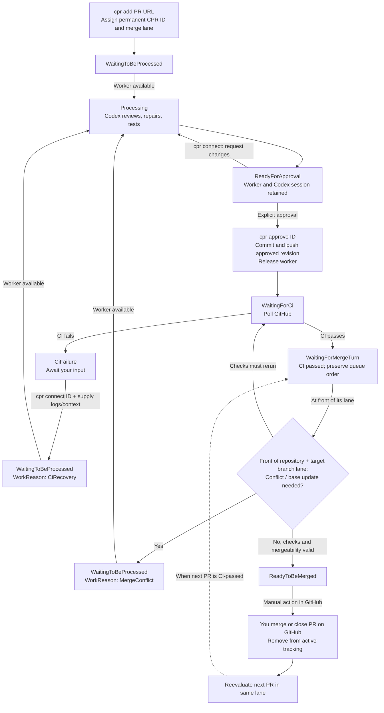

# CPR

This is a personal project for managing GitHub pull requests through Codex workers on a Linux server. A Bash client submits one PR at a time, opens worker sessions, and approves the resulting changes. An ASP.NET Core service coordinates the queue and keeps its state in SQL Server.

Work advances independently for each repository and target branch. Each assigned worker keeps its checkout through review and publication, so the same work can be picked up again from the client. Changes require explicit approval before they are pushed; merging remains a separate action in GitHub.

- ASP.NET Core and EF Core SQL Server for queue and worker state
- Bash client with seven commands and one config file
- persistent Git checkouts and Codex sessions on Linux workers
- SSH access for interactive work and local checkout copies
- approval tied to the exact prepared Git tree
- GitHub CI monitoring with interactive recovery for failed checks
- Docker Compose for worker startup, SSH identities, and Git configuration
- GPU assignment per worker, without a fixed GPU count

## Flow



`cpr add` queues one pull request. The orchestrator assigns a worker and prepares it for review. `cpr connect` opens Codex on that worker and snapshots edits when the session exits successfully. `cpr approve` authorizes publication of the prepared changes. Failed CI requires interactive recovery through `cpr connect`. Failed or interrupted reviews can also be reopened with `cpr connect`; a worker accepts only one active operation at a time.

## Orchestrator

`orchestrator/` contains the .NET application. `Program.cs` hosts ASP.NET Core, `Controller/` exposes the HTTP API, and `Service/` groups queue processing, GitHub operations, SSH, and command execution.

`SQL/` contains the EF Core context, entities, and enums. The schema is created manually with [Create.sql](orchestrator/Create.sql), which creates the `CPR` database, tables, indexes, nine example workers, and two prompts. The application does not run migrations or modify its schema at startup. Only the orchestrator receives the database connection.

`GitStoragePath` is the orchestrator's staging directory for bare Git repositories. It fetches approved worker commits there, checks their contents, and pushes them to GitHub. The container uses `/data/git`; worker checkouts live separately under `/workspace/repo`.

Run one orchestrator instance. Public GitHub PR checkouts are supported; private repository fetching and publication to contributor forks are not implemented.

### HTTP API

| Endpoint | Purpose |
|---|---|
| `GET /health` | API health |
| `GET /health/db` | SQL Server connectivity |
| `GET /api/status` | Pull request queue |
| `POST /api/pr` | Add one PR with `{ "url": "..." }` |
| `GET /api/worker` | Worker status and assignments |
| `PUT /api/worker/{id}/status` | Set worker status with `{ "status": "Paused" }` |
| `GET /api/pr/{id}/connection` | Worker SSH connection metadata |
| `POST /api/pr/{id}/connect` | Request an interactive session or CI recovery |
| `POST /api/pr/{id}/complete` | Snapshot edits after Codex exits |
| `POST /api/pr/{id}/approve` | Approve the prepared changes |
| `GET /api/prompt` | Stored prompts |
| `GET /api/prompt/{kind}` | One prompt |
| `PUT /api/prompt/{kind}` | Update a prompt with `{ "content": "..." }` |

Prompt kinds are `InitialReview` and `MergeConflict`. Templates support `{{PullRequestUrl}}`, `{{Repository}}`, `{{TargetBranch}}`, `{{Number}}`, and `{{CprId}}`. CI recovery takes its instructions from the interactive session.

Both seeded prompts follow applicable `AGENTS.md`, `CODE_STYLE.md`, and `docs/helpful-pr-review-guidelines.md`. The merge prompt also reviews the resolved result. Reports are written outside the checkout and retained under `/state/cpr/jobs/ID/report.md` on the worker.

## Workers

`server/` contains `compose.yaml` and the worker `Dockerfile`. Compose uses the published orchestrator image directly and builds the Codex/Git/SSH worker image on the server. A separate worker image does not need to be pushed to a registry.

The example has nine workers: 101–103 use GPU `0`, 104–106 use GPU `1`, and 107–109 use GPU `2`. Each worker defines its own `device_ids`; GPU indices and UUIDs are supported. Change these assignments to match the machine, or remove a worker's `deploy` block to run it without a GPU.

Compose creates the SSH identities, worker Git configuration, and persistent directories under `data/`. Checkouts, Codex state, and SSH identities survive container restarts. Back up `data/` and the SQL Server database when moving the deployment.

Workers use `seccomp=unconfined` so Codex can create its sandbox namespaces inside Docker. Codex runs with `workspace-write`; the worker root filesystem remains read-only, and GitHub publication credentials stay in the orchestrator.

## Client

`client/` contains the `cpr` executable and its config template. The client runs through Bash and can be invoked from fish or any other shell. Python and fish are not dependencies; rsync is needed for `checkout`.

| Command | Purpose |
|---|---|
| `cpr help` | List the commands |
| `cpr status` | Show the pull request queue and CPR IDs |
| `cpr workers` | Show worker status and assignments |
| `cpr add https://github.com/OWNER/REPO/pull/123` | Queue one pull request |
| `cpr checkout ID` | Copy the assigned worker checkout locally |
| `cpr connect ID` | Open Codex on the assigned worker |
| `cpr approve ID` | Approve the prepared changes for publication |

These are the only seven commands. Use the CPR ID from `status` for `checkout`, `connect`, and `approve`.

## Setup

### Server

The server needs Docker with Compose 2.23.1 or later. GPU workers also need NVIDIA Container Toolkit. The orchestrator uses an existing SQL Server instance; the server host does not need .NET installed.

From the local checkout, set `tempRegistry` in [PushToDocker.sh](orchestrator/PushToDocker.sh), then build and push the orchestrator image:

```sh
./orchestrator/PushToDocker.sh
```

Run [Create.sql](orchestrator/Create.sql) once against SQL Server before starting the orchestrator. Use SSMS or run the following from the repository root; `sqlcmd` prompts for the password:

```sh
sqlcmd -S YOUR_SQL_SERVER -U sa -b -i orchestrator/Create.sql
```

Copy `server/compose.yaml` and `server/Dockerfile` to a directory such as `~/cpr` on the server. An orchestrator source checkout is not needed there. Edit `x-settings` in `compose.yaml` with the published image reference, database connection, GitHub token, Git name/email, and desktop SSH public key. Keep the configured copy private, and write literal dollar signs as `$$` in Compose values.

Start the containers on the server:

```sh
cd ~/cpr
docker compose pull cpr-orchestrator
docker compose up -d --build
```

Worker execution and publication start disabled. Complete the client SSH setup below and sign in to Codex on each worker before enabling them.

The API listens on `127.0.0.1:18080`, and worker SSH ports listen on `127.0.0.1:22101`–`22109`. `docker compose logs --tail=100` shows startup output; `docker compose down` stops the deployment.

### Client

From the repository root on CachyOS, in any shell:

```sh
sudo pacman -Syu --needed bash curl jq openssh rsync
sudo install -m 755 client/cpr /usr/local/bin/cpr
install -Dm 600 client/config ~/.config/cpr/config
cpr help
```

The executable goes in `/usr/local/bin/cpr`. Copy the config once to `~/.config/cpr/config` and edit it there; updating the executable does not require replacing the config.

```ini
CPR_API_URL=http://127.0.0.1:18080
CPR_CHECKOUT_DIR=~/.local/share/cpr/checkouts
CPR_HTTP_TIMEOUT=120
```

These settings control the API address, local checkout directory, and HTTP timeout in seconds. Use plain `KEY=value` lines without quotes or shell expressions. This file is the client's only configuration source; there are no command-line or environment-variable overrides.

### SSH

Forward the server's API over SSH. Replace `server` with your server alias or `user@hostname`, leave this terminal open, and run CPR in another terminal:

```sh
ssh -N -L 127.0.0.1:18080:127.0.0.1:18080 server
```

The CPR API does not require an API key. GitHub credentials stay in the orchestrator.

`connect` and `checkout` also need the worker SSH aliases. After starting the server, copy its worker host keys to the client, adjusting the server directory if necessary:

```sh
mkdir -p ~/.ssh
scp server:~/cpr/data/keys/cpr-worker-known_hosts ~/.ssh/cpr-worker-known_hosts
chmod 600 ~/.ssh/cpr-worker-known_hosts
```

Compare the keys with `ssh-keygen -lf ~/cpr/data/keys/cpr-worker-known_hosts` on the server. Add these blocks to `~/.ssh/config`, keeping the existing server configuration. Replace `server` with the server alias and `IdentityFile` with the private key matching `desktop-public-key` in Compose:

```sshconfig
Host cpr-101 cpr-102 cpr-103 cpr-104 cpr-105 cpr-106 cpr-107 cpr-108 cpr-109
    HostName 127.0.0.1
    User coder
    ProxyJump server
    IdentityFile ~/.ssh/id_ed25519_gpu
    IdentitiesOnly yes
    UserKnownHostsFile ~/.ssh/cpr-worker-known_hosts
    StrictHostKeyChecking yes

Host cpr-101
    Port 22101
    HostKeyAlias cpr-101
Host cpr-102
    Port 22102
    HostKeyAlias cpr-102
Host cpr-103
    Port 22103
    HostKeyAlias cpr-103
Host cpr-104
    Port 22104
    HostKeyAlias cpr-104
Host cpr-105
    Port 22105
    HostKeyAlias cpr-105
Host cpr-106
    Port 22106
    HostKeyAlias cpr-106
Host cpr-107
    Port 22107
    HostKeyAlias cpr-107
Host cpr-108
    Port 22108
    HostKeyAlias cpr-108
Host cpr-109
    Port 22109
    HostKeyAlias cpr-109
```

Sign in with your ChatGPT account on each worker, using its SSH alias:

```sh
ssh -t cpr-101 codex login --device-auth
```

Repeat for `cpr-102` through `cpr-109`. Codex credentials persist in each worker's state directory.

After signing in to Codex on the workers, set `run-workers` and `publish-approved` to `'true'` in the server's `compose.yaml` and run `docker compose up -d` again. Publication still requires `cpr approve ID`.

## Local Development

Install the development dependencies on CachyOS:

```sh
sudo pacman -Syu --needed dotnet-sdk aspnet-runtime aspnet-targeting-pack github-cli git openssh
```

Create or edit `orchestrator/appsettings.Private.json` alongside `Program.cs`:

```json
{
  "ConnectionStrings": {
    "CPR": "Server=127.0.0.1,1433;Database=CPR;User Id=sa;Password=CHANGE_ME;Encrypt=True;TrustServerCertificate=True;"
  },
  "GH_TOKEN": "YOUR_GITHUB_TOKEN",
  "CPR": {
    "GitAuthorName": "Your Name",
    "GitAuthorEmail": "you@example.com",
    "GitStoragePath": "data/git"
  }
}
```

Use a database dedicated to CPR and run `orchestrator/Create.sql` before the first start. `TrustServerCertificate=True` in this example is for local development with a self-signed SQL Server certificate.

`appsettings.json` holds shared defaults. `appsettings.Private.json` holds local overrides and is excluded from Git, publishing, and Docker builds. Environment variables override both JSON files, and command-line settings take precedence over those.

```sh
cd orchestrator
dotnet run --project CPR.csproj --launch-profile CPR
```

The local API listens at `http://localhost:5000`. Set `CPR_API_URL=http://localhost:5000` in the client config to use it. Worker execution and publication remain disabled until enabled in the private settings. To operate the server workers from a local run, configure the same worker SSH aliases and credentials, then enable `IsWorkerExecutionEnabled` and `IsPublicationEnabled`.

### Docker

The `Docker` launch profile uses Linux host networking, mounts the private settings file at `/app/appsettings.Private.json`, and listens on port 5000. Select it in an IDE with Docker launch support; `CPR.csproj.user` remembers the selected profile. The equivalent commands are:

```sh
cd orchestrator
docker build -t cpr:latest .
docker run --rm --network host \
  --mount type=bind,source="$PWD/appsettings.Private.json",target=/app/appsettings.Private.json,readonly \
  --env ASPNETCORE_ENVIRONMENT=Development \
  --env ASPNETCORE_URLS=http://127.0.0.1:5000 \
  --env CPR__GitStoragePath=/data/git \
  cpr:latest
```

The local Docker profile starts the API only. The server Compose deployment supplies the worker containers, persistent Git storage, and orchestrator SSH configuration; its API stays on `127.0.0.1:18080` for the tunnel.
