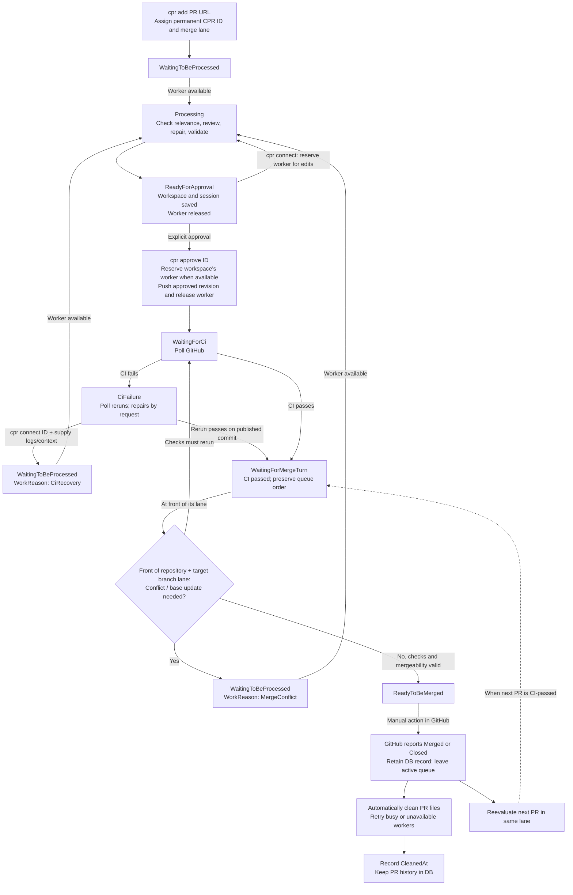

# CPR

This is a personal project for managing GitHub pull requests through Codex workers on a Linux server. A Bash client submits one PR at a time, opens worker sessions, and approves the resulting changes. An ASP.NET Core service coordinates the queue and keeps its state in PostgreSQL.

Work advances independently for each repository and target branch. Each PR keeps its own checkout and saved Codex session. A completed review releases its worker while awaiting approval, so that worker can process other PRs. Changes require explicit approval before they are pushed; merging remains a separate action in GitHub.

- ASP.NET Core and EF Core with Npgsql for queue and worker state
- Bash client with one config file
- persistent Git checkouts and Codex sessions on Linux workers
- SSH access for interactive work and local checkout copies
- approval tied to the exact prepared Git tree
- GitHub CI monitoring with interactive recovery for failed checks
- optional Discord webhook messages for PR status changes
- retained `Merged` and `Closed` records with automatic PR file cleanup
- Docker Compose for worker startup, SSH identities, and Git configuration
- GPU assignment per worker, without a fixed GPU count

## Flow



`cpr add` queues one pull request. The orchestrator assigns a worker and prepares it for review. Successful validation saves the exact Git tree and releases the active worker assignment. `cpr connect` requests a worker for interactive edits; if it is busy, run the command again once assigned. Exiting Codex successfully runs final validation and releases the worker again. `cpr approve` authorizes publication of the prepared changes and queues a brief reservation of the worker holding that workspace. Publication, interactive requests, and explicit rereviews take priority over new reviews when their worker becomes available.

`cpr review ID` requests another AI review, including after approval or publication. It clears pending approval, fetches the latest comments when the worker starts, and explicitly reassesses new or unresolved feedback. Saved unpublished work stays on its workspace worker, and the review resumes its Codex session when available. After publication, a new checkout uses the current PR head. Successful rereview returns to `ReadyForApproval` and releases the worker; publishing requires another `cpr approve ID`. New comments alone do not trigger a review.

`cpr review ID --resolution "..."` records an explicit maintainer decision and queues rereview. The decision can resolve named repository policy or licensing findings; it is included in every review and final-validation attempt and retained in each run's history. Required notices, attribution, and remaining technical checks still apply. Acceptance is recorded as a maintainer decision, not independent verification of provenance. The current decision remains in effect for this PR until replaced; ordinary `review ID` preserves it, and `review ID --resolution ""` clears it for subsequent runs. `cpr show ID` displays both the current decision and each run's captured decision. An active automated review must finish or be cancelled before a new decision is submitted. Publication still requires separate approval.

`cpr remove ID` stops tracking and records `Removed`, preserving the saved work and database history. Removed PRs leave merge ordering and GitHub polling. `cpr add URL` or `cpr review ID` resumes tracking under the same CPR ID. `cpr purge ID` stops tracking and explicitly requests deletion of all PR files, including unpublished edits; the database record and compact review history remain. Purge also retries cleanup for completed records.

When GitHub reports a merge or closure, CPR records `Merged` or `Closed` with `CompletedAt` and immediately excludes that PR from merge ordering and new work. The database record remains. `cpr status` includes these terminal records and shows file cleanup as `Pending` or `Done`. Terminal records cannot be removed, reviewed, approved, or connected to through the client. If a closed PR is reopened on GitHub, `cpr add URL` queues it again under its existing CPR ID after cleanup finishes.

Cleanup runs automatically when worker execution is enabled. Merged and closed PRs retain only database history: CPR deletes their checkouts, build outputs, archived checkouts, CPR job state, raw review evidence, scratch directories, and orchestrator publishing repository. `StorageWorkerIds` records workers that still hold files; each successful deletion removes that worker from the list. Shared tool caches, Codex account/runtime data, SSH configuration, and other PRs remain. Compact results, checks, findings, limitations, tree hashes, and usage are saved in `ReviewRun` before the files are deleted.

Active operations finish before cleanup starts. Worker filesystem locks also protect open interactive sessions. A worker is released as soon as its copy is cleaned, even if cleanup remains pending elsewhere. Busy, offline, or paused workers and failed deletions are retried; already cleaned workers are not contacted again. `CleanupRequestedAt` records the request and `CleanedAt` is set after every recorded copy and orchestrator storage are deleted. `LastError` explains pending work. Neither merge nor closure pauses the worker. Records deleted by older CPR versions cannot be cleaned automatically because their identities are no longer tracked.

`remove`, `review`, and `purge` reject an automated operation already running on that PR. `cpr cancel ID` stops the selected automated review, revokes approval, preserves edits, and records `Blocked`; it never interrupts publication or kills an interactive session. Exit an interactive session before releasing its worker. Cancellation targets the registered review process group, with an operation identifier and process identity check. If cancellation cannot be confirmed, the worker stays reserved until it is idle. Pending approval is cleared before attempts to release work. Rereview archives a saved checkout when the upstream revision changed and tells the reviewer to recover any still-relevant repairs from it.

Failed CI continues polling against the commit CPR published, so a rerun can recover without another review. `cpr connect` or `cpr review` explicitly requests code repair. A changed PR head, destination branch, or reviewed target revision invalidates approval and records `Blocked`. Freshness is checked at review completion, approval, and immediately before publication. Failed, blocked, cancelled, and interrupted automated reviews release their worker once its filesystem lock is free; their checkout remains available for `review`, `connect`, or `checkout`. Startup marks interrupted work blocked instead of leaving it permanently `Processing`.

Use `cpr workers` to find a worker's ID, then `cpr pause 101` to stop new assignments while you perform maintenance. Existing work continues; wait for its assignment to clear before stopping the worker. Paused workers also skip health checks and new cleanup operations. `cpr resume 101` sets the worker back to `Online`, allowing scheduling and health checks again. Pause persists until you explicitly resume it.

## Orchestrator

`orchestrator/` contains the .NET application. `Program.cs` hosts ASP.NET Core, `Controller/` exposes the HTTP API, and `Service/` groups queue processing, GitHub operations, SSH, and command execution.

`SQL/` contains the EF Core context, entities, and persistence enums. [Create.sql](orchestrator/Create.sql) creates the `cpr` schema in your existing PostgreSQL database, its three tables (`Worker`, `PullRequest`, `ReviewRun`), indexes, and nine example workers. It also creates the `cpr_app` login and grants runtime access to those tables. `PullRequest.CompletedAt` records GitHub's merge or closure time (falling back to the time CPR observes it); `CleanedAt` records successful file cleanup. The application does not run migrations or create schema. After updating for maintainer resolutions, rerun `Create.sql` to add the nullable `PullRequest.MaintainerResolution` column before deploying the new orchestrator and client. Only the orchestrator receives the database connection. Review prompts live in application configuration.

`GitStoragePath` is the orchestrator's staging directory for bare Git repositories. It fetches approved worker commits there, checks their contents, and pushes them to GitHub. The container uses `/data/git`; each PR's checkout lives at `/workspace/jobs/ID/repo` on its workspace worker. `/workspace/repo` points to the currently selected checkout.

`PullRequest.WorkerId` records an active reservation; `WorkspaceWorkerId` records where unpublished work is saved. While awaiting your approval, `WorkerId` is null and the workspace remains intact, including its index, uncommitted merge, build outputs, and Codex session. Approval and interactive editing use the same workspace worker, waiting if it is busy or offline. `cpr checkout` copies the saved PR directory without reserving a worker. Workspaces are not transferred between workers.

Run one orchestrator instance. Public GitHub PR checkouts are supported; private repository fetching and publication to contributor forks are not implemented.

### HTTP API

| Endpoint | Purpose |
|---|---|
| `GET /health` | API health |
| `GET /health/db` | PostgreSQL connectivity |
| `GET /api/status` | Pull requests, terminal history, and cleanup timestamps |
| `GET /api/pr/{id}` | Review summaries, findings, checks, usage, and next action |
| `POST /api/pr/{id}/cancel` | Stop review work, preserve edits, and release its worker when idle |
| `POST /api/pr/{id}/purge` | Delete PR files, including edits; retain database history |
| `POST /api/pr` | Add one PR with `{ "url": "..." }` |
| `DELETE /api/pr/{id}` | Stop tracking; retain a Removed record and saved work |
| `POST /api/pr/{id}/review` | Queue rereview and invalidate approval; optional `{ "resolution": "..." }` records a maintainer decision (up to 16,000 characters) |
| `GET /api/worker` | Worker status and assignments |
| `PUT /api/worker/{id}/status` | Set worker status with `{ "status": "Paused" }` |
| `GET /api/pr/{id}/connection` | Saved checkout's SSH host and PR directory |
| `POST /api/pr/{id}/connect` | Request an interactive session or CI recovery |
| `POST /api/pr/{id}/complete` | Validate interactive edits and snapshot the validated tree |
| `POST /api/pr/{id}/approve` | Approve the prepared changes |

### Discord webhook notifications

CPR checks saved PR statuses every five seconds and posts new or changed statuses to a Discord text channel. Messages include the PR link, CPR ID, status, observation time, and `cpr show ID`; blocked and failed CI updates include a shortened reason. Link previews and thumbnails are suppressed; links remain clickable. Existing PRs establish the starting point when the orchestrator starts and are not announced. Notifications do not require any database changes.

Create a webhook for your channel under **Server Settings → Integrations → Webhooks**. Keep its URL private and merge these settings into the existing `CPR` object in the ignored `orchestrator/appsettings.Private.json`:

```json
{
  "CPR": {
    "Discord": {
      "IsEnabled": true,
      "WebhookUrl": "https://discord.com/api/webhooks/YOUR_WEBHOOK_ID/YOUR_WEBHOOK_TOKEN"
    }
  }
}
```

For Compose, set `discord-enabled` and `discord-webhook-url` in your private copy of `server/compose.yaml`. Use the URL exactly as copied, without query parameters or a `/github` suffix, and restart the orchestrator manually after changing configuration. Startup validates enabled webhook URLs; an empty URL is allowed while disabled.

Delivery is best effort: the last delivered statuses are kept in memory, with no notification table or delivery backlog. Brief intermediate statuses between checks and changes during downtime may be missed. Failures retry the latest status after a minute, or longer when Discord requests it; a timeout after Discord accepts a message can cause a duplicate. HTTP 401/403/404 stops notifications until you correct the configuration and restart. Notifications run independently of reviews. `docker compose logs --tail=100 cpr-orchestrator` reports delivery results without logging the webhook URL or message contents.

### Review configuration

Git preparation and target integration run in the worker script. The orchestrator captures the PR description, paginated discussion and reviews, closing issues and their comments, and up to 50 recently updated PRs targeting the same branch. The reviewer checks whether the proposed change is still needed and inspects related PRs for duplication, overlap, or superseding work before making repairs. The candidate list is bounded, not an exhaustive search; the reviewer must record its scope and investigate further when necessary. An obsolete PR or unresolved relevance decision stops the job for inspection without automatically closing anything on GitHub.

`CPR:Prompts` in [appsettings.json](orchestrator/appsettings.json) holds the ten named prompt strings: `InitialReview`, `MergeConflict`, `Rereview`, `SharedReview`, `Correctness`, `Resources`, `Cleanup`, `Evidence`, `FinalValidation`, and `Relevance`. They incorporate the personal review standards directly, including memory lifetime analysis and targeted measurements. A separate `helpful-pr-review-guidelines.md` is unnecessary. Applicable repository `AGENTS.md` and `CODE_STYLE.md` still apply. Templates support `{{PullRequestUrl}}`, `{{Repository}}`, `{{TargetBranch}}`, `{{Number}}`, and `{{CprId}}`. Startup rejects missing, blank, or oversized prompts. Prompts are configured as complete strings, with `\n` representing line breaks.

`CPR:ReviewSteps` in [appsettings.json](orchestrator/appsettings.json) controls the enabled steps in order. Each has `Name`, `Model`, `ReasoningEffort`, `TimeoutSeconds`, `MaxAttempts`, `Prompts`, and optional `IsEnabled` (default `true`). Model and effort names must be supported by the installed Codex CLI and account; unsupported settings fail visibly. There is no silent model fallback.

The default is a review with GPT-6 Sol high followed by final validation with Astra xHigh in the same Codex session. This reduces the initial review's model cost while retaining the deeper follow-up from the observed Astra-only workflow. It is a starting configuration to evaluate: the nine historical reviews did not compare cheaper models, and total cost depends on actual token usage, caching, and retries. Models and effort can differ by step; there is no automatic risk-based model selection or escalation. A separate relevance-only first step can use `Prompts: ["Relevance"]`; another step must remain for the full review. The final enabled step always receives correctness, resources, cleanup, and final-validation requirements. Shared instructions, relevance, and evidence requirements accompany every step.

Settings can be overridden in private JSON or Compose environment variables, for example `CPR__ReviewSteps__0__Model` or `CPR__Prompts__Resources`. A prompt override replaces that entire string while other named prompts retain their defaults. Restart the orchestrator after configuration changes. .NET configuration merges arrays by index: supplying a shorter array does not remove later defaults. Set `CPR__ReviewSteps__1__IsEnabled=false` for a single combined review and validation, and replace all existing prompt indices when changing a step's assignment. Disable unwanted steps explicitly. Routing and review policy are both configured here; there is no prompt-editing HTTP API.

Each step has a time limit and a bounded number of attempts. A coherent but incomplete result receives a continuation listing the failed completion requirements and focused on its missing evidence; process failures, blockers, and unresolved relevance stop without repeatedly spending the remaining attempts. Completion requires structured coverage, consistent check results, retained evidence files, required resource measurements, and a final diff check. This gate checks the evidence contract, not the truth of every model judgment. Codex resolves conflicts in working-tree files while its Git index remains read-only; unmerged index entries alone do not block a completed content review. The runner checks the final working-tree snapshot for conflict markers and whitespace errors before accepting the final attempt, then stages the validated contents itself. The snapshot must match the tree validated by the final attempt. Interactive completion runs the last enabled step and uses a longer client timeout derived from that step's budget.

Full review files live under `/state/cpr/jobs/ID/runs/RUN/` on the worker until merge, closure, or explicit purge. Each run retains the plan, captured context, prompts, Codex events, stderr, evidence, structured results, hashes, usage, and final patch when successful. Each attempt has its own directory. `cpr show ID` reads the compact history in PostgreSQL, including each attempt's structured result, checks, findings, limitations, diff statistics, models, effort, and token usage. Attempt summaries and findings identify what each model reported. It works after file cleanup; raw evidence and patches are deleted. Input usage includes cached input tokens; no fixed prices are assumed. Usage totals are complete only when the process succeeds and every started turn reports valid usage. Interrupted or incomplete streams retain known totals as lower bounds; absent totals are unknown. Older records without an explicit completeness flag also display recorded totals as lower bounds. Results already deleted by older versions cannot be recovered. Export any raw evidence needed later before merging, closing, or purging.

## Workers

`server/` contains `compose.yaml`, the worker `Dockerfile`, `sshd_config`, and `worker-instructions.md`. Compose loads the two config files from disk so they can be mounted into read-only containers. Compose uses the published orchestrator image directly and builds the Codex/Git/SSH worker image on the server. A separate worker image does not need to be pushed to a registry. The image includes stable Rust with rustfmt, Clippy, rustdoc, and the `wasm32-unknown-unknown` target, available to SSH sessions without installing components into the read-only root filesystem. Rebuild and recreate existing workers to pick up toolchain changes; persistent checkouts and review evidence remain in `data/`.

The example has nine workers: 101–103 use GPU `0`, 104–106 use GPU `1`, and 107–109 use GPU `2`. Each worker defines its own `device_ids`; GPU indices and UUIDs are supported. Change these assignments to match the machine, or remove a worker's `deploy` block to run it without a GPU.

Compose creates the SSH identities, worker Git configuration, and persistent directories under `data/`. Checkouts, Codex state, and SSH identities survive container restarts. Back up `data/` and the PostgreSQL database when moving the deployment.

Workers retain `AUDIT_WRITE` so sshd can record interactive logins. Without it, `cpr connect` closes before Codex starts and worker logs report `linux_audit_write_entry failed: Operation not permitted`. After adding this capability to an existing deployment, recreate idle workers with `docker compose up -d --no-deps w101 w102 w103` (adjust the worker names for your deployment).

Workers use `seccomp=unconfined` so Codex can create its sandbox namespaces inside Docker. Automated reviews and `cpr connect` run Codex with `workspace-write` and `sandbox_workspace_write.network_access=true`, allowing shell commands to download dependencies and access remote sources. Both launch paths also grant write access to `/state/cargo` with `--add-dir`, so Cargo can populate its persistent dependency cache. Worker `/tmp` permits execution so Rust doctests and temporary compiled probes can run. The worker root filesystem remains read-only, and GitHub publication credentials stay in the orchestrator.

## Client

`client/` contains the `cpr` executable and its config template. The client runs through Bash and can be invoked from fish or any other shell. Python and fish are not dependencies; rsync is needed for `checkout`.

| Command | Purpose |
|---|---|
| `cpr help` | List the commands |
| `cpr status` | Show PRs, terminal history, CPR IDs, and cleanup status |
| `cpr show ID` | Inspect review results, checks, usage, and the next action |
| `cpr cancel ID` | Stop a review and preserve edits |
| `cpr purge ID` | Stop tracking and delete PR files; retain database history |
| `cpr workers` | Show worker status and assignments |
| `cpr pause WORKER_ID` | Pause new assignments while current work continues |
| `cpr resume WORKER_ID` | Make a paused worker available again |
| `cpr add https://github.com/OWNER/REPO/pull/123` | Queue one pull request |
| `cpr remove ID` | Untrack a PR and preserve saved work |
| `cpr review ID [--resolution TEXT]` | Reassess feedback, optionally record a maintainer decision, and require fresh approval |
| `cpr checkout ID` | Copy the saved PR checkout locally |
| `cpr connect ID` | Reserve its workspace worker and open Codex |
| `cpr approve ID` | Approve the prepared changes for publication |

Use the CPR ID from `status` for commands that take `ID`. Worker commands use the ID from `workers`.

## Setup

### Server

The server needs Docker with Compose 2.23.1 or later. GPU workers also need NVIDIA Container Toolkit. The orchestrator uses an existing PostgreSQL database; the server host does not need .NET installed.

From the local checkout, set `tempRegistry` in [PushToDocker.sh](orchestrator/PushToDocker.sh), then build and push the orchestrator image:

```sh
./orchestrator/PushToDocker.sh
```

Run [Create.sql](orchestrator/Create.sql) in the destination database as its administrator before starting the orchestrator. The administrator must be able to create roles and own the CPR schema and tables. From the repository root, replace the host, database, and administrator username (`postgres` below):

```sh
psql -X -h YOUR_POSTGRES_HOST -p 5432 -U postgres -d YOUR_DATABASE \
  -v ON_ERROR_STOP=1 -f orchestrator/Create.sql -c '\password cpr_app'
```

The script creates `cpr_app` without a password; the final `psql` command prompts for one. Store that password in the orchestrator's private connection string. Existing role passwords are preserved when re-running the SQL. The login can read and update workers, and read, insert, update, and delete queue entries; it does not own the schema or tables. Entity mappings explicitly use `cpr`, so no connection-string search path is required.

The same script can be re-run without migrations. It preserves records and workers, adds the new PR columns and `ReviewRun`, and updates runtime grants. Status values remain compatible: `Merged = 7`, `Closed = 8`, `Blocked = 9`, `Removed = 10`. Stop the orchestrator after active work finishes before applying SQL and deploying. The one-time storage backfill conservatively includes every configured worker for older uncleared PRs; subsequent runs preserve cleanup progress. Older approvals without a pinned target revision require a fresh review. Existing worker `AGENTS.md` files are preserved by Compose; reconcile their report instructions with `worker-instructions` if needed.

Existing installations may still have `cpr."Prompt"`; CPR no longer reads it. Copy any customized database prompt text to the matching `CPR:Prompts` settings before deploying. After switching to the new version, the obsolete table can be removed manually with `DROP TABLE IF EXISTS cpr."Prompt";`. `Create.sql` leaves it intact.

Confirm the application login can read the workers:

```sh
psql -X -h YOUR_POSTGRES_HOST -p 5432 -U cpr_app -d YOUR_DATABASE \
  -v ON_ERROR_STOP=1 -c 'SELECT count(*) FROM cpr."Worker";'
```

For remote TLS connections, the Compose example uses `SSL Mode=VerifyFull`; configure the PostgreSQL hostname and trusted CA certificate to match your server.

Copy `server/compose.yaml`, `server/Dockerfile`, `server/sshd_config`, and `server/worker-instructions.md` to the same directory, such as `~/cpr`, on the server. If using a configured `compose.private.yaml`, copy it as `compose.yaml`. An orchestrator source checkout is not needed there. Edit `x-settings` in `compose.yaml` with the published image reference, database connection, GitHub token, Git name/email, and desktop SSH public key. Keep the configured copy private, and write literal dollar signs as `$$` in Compose values.

Start the containers on the server:

```sh
cd ~/cpr
docker compose pull cpr-orchestrator
docker compose up -d --build
```

Worker execution and publication start disabled. Complete the client SSH setup below and sign in to Codex on each worker before enabling them.

The API listens on `127.0.0.1:18080`, and worker SSH ports listen on `127.0.0.1:22101`–`22109`. `docker compose logs --tail=100` shows startup output; `docker compose down` stops the deployment.

### Client

From the repository root on CachyOS, in any shell:

```sh
sudo pacman -Syu --needed bash curl jq openssh rsync
sudo install -m 755 client/cpr /usr/local/bin/cpr
install -Dm 600 client/config ~/.config/cpr/config
cpr help
```

The executable goes in `/usr/local/bin/cpr`. Copy the config once to `~/.config/cpr/config` and edit it there; updating the executable does not require replacing the config.

```ini
CPR_API_URL=http://127.0.0.1:18080
CPR_CHECKOUT_DIR=~/.local/share/cpr/checkouts
CPR_HTTP_TIMEOUT=120
```

These settings control the API address, local checkout directory, and ordinary HTTP timeout in seconds. Final validation after `connect` uses the server's review budget instead. Use plain `KEY=value` lines without quotes or shell expressions. This file is the client's only configuration source; there are no command-line or environment-variable overrides.

### SSH

Forward the server's API over SSH. Replace `server` with your server alias or `user@hostname`, leave this terminal open, and run CPR in another terminal:

```sh
ssh -N -L 127.0.0.1:18080:127.0.0.1:18080 server
```

The CPR API does not require an API key. GitHub credentials stay in the orchestrator.

`connect` and `checkout` also need the worker SSH aliases. After starting the server, copy its worker host keys to the client, adjusting the server directory if necessary:

```sh
mkdir -p ~/.ssh
scp server:~/cpr/data/keys/cpr-worker-known_hosts ~/.ssh/cpr-worker-known_hosts
chmod 600 ~/.ssh/cpr-worker-known_hosts
```

Compare the keys with `ssh-keygen -lf ~/cpr/data/keys/cpr-worker-known_hosts` on the server. Add these blocks to `~/.ssh/config`, keeping the existing server configuration. Replace `server` with the server alias and `IdentityFile` with the private key matching `desktop-public-key` in Compose:

```sshconfig
Host cpr-101 cpr-102 cpr-103 cpr-104 cpr-105 cpr-106 cpr-107 cpr-108 cpr-109
    HostName 127.0.0.1
    User coder
    ProxyJump server
    IdentityFile ~/.ssh/id_ed25519_gpu
    IdentitiesOnly yes
    UserKnownHostsFile ~/.ssh/cpr-worker-known_hosts
    StrictHostKeyChecking yes

Host cpr-101
    Port 22101
    HostKeyAlias cpr-101
Host cpr-102
    Port 22102
    HostKeyAlias cpr-102
Host cpr-103
    Port 22103
    HostKeyAlias cpr-103
Host cpr-104
    Port 22104
    HostKeyAlias cpr-104
Host cpr-105
    Port 22105
    HostKeyAlias cpr-105
Host cpr-106
    Port 22106
    HostKeyAlias cpr-106
Host cpr-107
    Port 22107
    HostKeyAlias cpr-107
Host cpr-108
    Port 22108
    HostKeyAlias cpr-108
Host cpr-109
    Port 22109
    HostKeyAlias cpr-109
```

Sign in with your ChatGPT account on each worker, using its SSH alias:

```sh
ssh -t cpr-101 codex login --device-auth
```

Repeat for `cpr-102` through `cpr-109`. Codex credentials persist in each worker's state directory.

After signing in to Codex on the workers, set `run-workers` and `publish-approved` to `'true'` in the server's `compose.yaml` and run `docker compose up -d` again. Publication still requires `cpr approve ID`.

## Local Development

Install the development dependencies on CachyOS:

```sh
sudo pacman -Syu --needed dotnet-sdk aspnet-runtime aspnet-targeting-pack github-cli git openssh
```

Create or edit `orchestrator/appsettings.Private.json` alongside `Program.cs`:

```json
{
  "ConnectionStrings": {
    "CPR": "Host=127.0.0.1;Port=5432;Database=db;Username=cpr_app;Password=REPLACE_ME"
  },
  "GH_TOKEN": "YOUR_GITHUB_TOKEN",
  "CPR": {
    "GitAuthorName": "Your Name",
    "GitAuthorEmail": "you@example.com",
    "GitStoragePath": "data/git"
  }
}
```

Run `orchestrator/Create.sql` in the selected PostgreSQL database and set the `cpr_app` password using the server setup instructions above. CPR stores its tables in the `cpr` schema, so the database can also contain other applications' schemas. Replace the connection string's host, database, and password with your settings.

`appsettings.json` holds shared defaults. `appsettings.Private.json` holds local overrides and is excluded from Git, publishing, and Docker builds. Environment variables override both JSON files, and command-line settings take precedence over those.

```sh
cd orchestrator
dotnet run --project CPR.csproj --launch-profile CPR
```

The local API listens at `http://localhost:5000`. Set `CPR_API_URL=http://localhost:5000` in the client config to use it. Worker execution and publication remain disabled until enabled in the private settings. To operate the server workers from a local run, configure the same worker SSH aliases and credentials, then enable `IsWorkerExecutionEnabled` and `IsPublicationEnabled`.

### Docker

The `Docker` launch profile uses Linux host networking, mounts the private settings file at `/app/appsettings.Private.json`, and listens on port 5000. Select it in an IDE with Docker launch support; `CPR.csproj.user` remembers the selected profile. The equivalent commands are:

```sh
cd orchestrator
docker build -t cpr:latest .
docker run --rm --network host \
  --mount type=bind,source="$PWD/appsettings.Private.json",target=/app/appsettings.Private.json,readonly \
  --env ASPNETCORE_ENVIRONMENT=Development \
  --env ASPNETCORE_URLS=http://127.0.0.1:5000 \
  --env CPR__GitStoragePath=/data/git \
  cpr:latest
```

The local Docker profile starts the API only. The server Compose deployment supplies the worker containers, persistent Git storage, and orchestrator SSH configuration; its API stays on `127.0.0.1:18080` for the tunnel.
