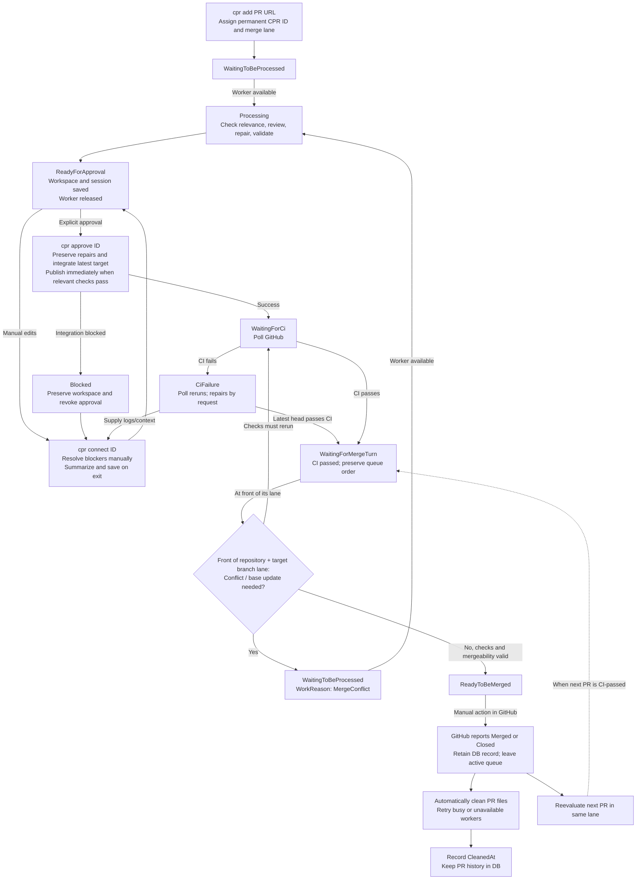

# CPR reference

[Daily workflow](../README.md) · [Code style](../CODE_STYLE.md)

## Flow



`cpr add` queues one pull request. A completed review saves the exact Git tree and releases its worker. `cpr approve ID` reserves that workspace, preserves saved repairs, finishes any pending merge, and integrates the latest target if it advanced. Required integration checks must pass before CPR publishes immediately under the same approval. A failure keeps the work and reports available through `cpr connect ID`, which opens a manual session and summarizes its changes on successful exit. Use `cpr review ID` for a full rereview. Approval and operation completion wake the scheduler immediately; it does not wait for the regular poll interval. Publication, manual sessions, and explicit rereviews take priority over new reviews when their worker becomes available.

The final review proposes a descriptive commit subject prefixed with `Auto: ` and an optional body based on the changes CPR will commit, for example `Auto: Preserve pixel precision when reopening graphs`. `cpr show ID` and the saved report display this message before approval; publication uses the message retained for the exact reviewed tree. Subjects are limited to 72 characters including the prefix and messages to 4,000 characters. A no-change review without a pending merge keeps the existing commit. Older pending snapshots without a proposed message need `cpr review ID` and fresh approval before a new commit can be published. Existing published commits are unchanged.

For the first publication, the final worker also writes a separate GitHub-ready `pr_comment` with a readable overview, meaningful CPR changes, findings and their disposition, validation, optimization and memory conclusions, and limitations. Final validation refreshes it after the last edit, including for reviews with no code changes. Preview the exact proposed text with `cpr show ID --comment` before approval. CPR binds it to the completed review run and reviewed tree; older prepared snapshots without this comment require `cpr review ID` before approval.

When a PR or CPR change includes measured performance or memory optimizations, comments prefer visible Markdown tables with workload/metric, before, after, and change columns. PRs without such optimizations do not need performance tables or empty performance sections. Tables identify units and baselines, distinguish original PR gains from CPR's additional improvements, and keep timing uncertainty and resource tradeoffs nearby. Inspection-only conclusions stay in prose when no comparable measurements exist. Manual tweak summaries use the same preference only for optimizations with comparisons recorded in that session. Final validation checks any table values and calculated changes against retained evidence.

After a confirmed approved publication, CPR posts the saved comment with the published commit link. The first successful publication includes the full CR report. If approval was blocked and manual conflict resolution was needed, that report remains included, followed by the unpublished tweak-session summaries. Each later published revision gets a new comment describing its changes and relevant validation; repeated approval of an already published commit creates no duplicate. A push failure leaves the report pending. A confirmed push is recorded before worker release, so a release failure cannot lose its comment. Delivery runs independently, survives restarts and worker cleanup, and retries failed attempts after two minutes while publication is enabled. CPR records the comment ID and checks a hidden run marker before retrying an uncertain submission, avoiding duplicates after a lost response. A matching marker with changed text requires inspection and is not overwritten. `cpr show ID` displays delivery status, errors, and the comment link. Comment failures do not change the successful publication or CI state. These are ordinary conversation comments; CPR does not submit a GitHub approval review. The configured GitHub token needs permission to write PR comments (for a fine-grained token, Pull requests: write).

`cpr review ID` requests another AI review, including after approval or publication. It clears pending approval, fetches the latest comments when the worker starts, and explicitly reassesses new or unresolved feedback. Saved unpublished work stays on its workspace worker, and the review resumes its Codex session when available. After publication, a new checkout uses the current PR head. Successful rereview returns to `ReadyForApproval` and releases the worker; publishing requires another `cpr approve ID`. Human comments do not trigger an automatic review. New or edited CodeRabbit comments use the focused repair workflow below.

CodeRabbit feedback is watched automatically while worker execution and `CPR:IsCodeRabbitEnabled` are enabled. The watcher waits 10 seconds between completed sweeps (plus GitHub request time), including discussion comments, inline comments and submitted review bodies. Existing comments become its initial baseline; the ordinary initial review still receives them. New and edited finding versions are persisted and batched across restarts. Blank comments, generated walkthrough/status comments, and inline findings marked addressed do not trigger repairs. Review summaries require a positive `Actionable comments posted` count; a missing, blank, or zero count is ignored even when the summary includes nitpick or outside-diff sections. Inline commit remapping and review-info footer edits do not change a finding version; current code and unresolved content still determine repair scope. CPR waits while CodeRabbit's current-head check is running, then requires 15 quiet seconds after both the last comment change and observed check completion. If no check is available, it requires two quiet minutes. New comments reset the timer. Delays are configurable with `CodeRabbitPollSeconds`, `CodeRabbitQuietSeconds`, and `CodeRabbitFallbackQuietSeconds`. Authenticated [conditional requests](https://docs.github.com/en/rest/using-the-rest-api/best-practices-for-using-the-rest-api#use-conditional-requests-if-appropriate) reuse unchanged pages, and pagination is never silently truncated.

Once an idle tracked PR has an accepted original review, settled feedback queues one `FeedbackRepair` pass using `CPR:FeedbackRepairStep` (default `gpt-6-sol`, high effort, one attempt with no elapsed-time cutoff). The default `TimeoutSeconds: 0` disables both the worker deadline and the outer SSH command deadline; explicit cancellation and connection-failure detection remain active. A positive feedback timeout opts into an elapsed-time limit. It preserves unpublished work, examines each captured comment, fixes supported findings, and runs affected checks. Required checks may finish naturally; unrelated broad suites and repeated full-PR audits are not part of the assignment. Its scope is comment paths, unfinished edits since the last accepted snapshot, integration conflicts and subsequent repair paths; it never automatically escalates to a full review. Every comment gets a recorded disposition: fixed, already fixed, not applicable, or blocked. Fixed items require retained passing evidence. The first publication retains the original full report plus these focused updates. `cpr show ID` displays pending feedback, polling failures and per-comment outcomes.

Approved publications, manual sessions, active jobs, removed, merged and closed PRs are not interrupted. Comments arriving during work wait for a later batch; the same observed version does not start another attempt after success, failure or restart. Genuine blockers stay available for inspection. Repair waits for any approved publication to finish and returns successful work to `ReadyForApproval`; publishing still requires `cpr approve ID`. No GitHub reply, thread resolution, push or merge occurs just because feedback arrived. Apply the additive `ReviewFeedback` column in `src/Orchestrator/SQL/Create.sql` before deploying this watcher.

Automatic recovery stays in `Processing`; `cpr show ID` exposes its category, action, retry count, and next worker check. Temporary transport failures wait 30 seconds before reconciliation, with at most two persisted automatic retries. Live worker operations are polled without launching a duplicate. Authentication/configuration errors, explicit cancellation, changed snapshots, and unresolved maintainer decisions stop for intervention. Approval-time integration failures still revoke approval.

The worker retains a stage checkpoint and original evidence. Continuation reuses a compatible completed stage prefix, resumes the missing stage, and performs final validation against the current tree. Partial and manual edits require affected checks and guide assessments to be renewed. Earlier evidence is historical unless still applicable. Retry counts and consumed semantic attempts survive restarts; a new explicit review or manual repair starts a new request. Technical failures classified as missing evidence, unfinished review, a required check, or integration may receive a focused correction within the existing stage attempt limit. CodeRabbit still uses one focused attempt per captured batch; transient reconciliation does not create another feedback batch. Report-only problems continue through the existing bounded report-writing and diagnosis passes. Recovery does not bypass completion gates or publish without approval.

`cpr retry ID` repairs a failed final report using its saved review and checks. It requires the saved reviewed Git tree and evidence, with the same PR head, destination branch, publication history, and maintainer decision. It validates that original snapshot even when the target advances or later manual edits exist; recovered coverage never transfers to those changes. It never launches a code review or reruns tests. Demonstrated baseline failures mistakenly listed as verified support are removed from those reference lists only when passing support remains; the failed checks and original reports are preserved. Missing or invalid PR comments and commit messages receive a fresh, read-only writing pass configured by `CPR:ReportRepairStep` (default: `gpt-6-sol`, high effort, one attempt capped at three minutes), using only the saved result and outgoing diff summary. Existing valid publication text is retained. This pass cannot change findings, check results, or coverage claims. Every completion gate runs again. If the working tree and target still match, success returns to `ReadyForApproval` with separate publication approval still required. Otherwise CPR retains the completed historical report and directs you to `connect` for current integration. If a structural report failure stopped a completed review immediately before its final `validation` stage, recovery first requires all final coverage and evidence gates, then runs one read-only saved-evidence validation using the configured final model at low reasoning effort, capped at three minutes. This checks report consistency and referenced evidence without replaying execution transcripts or repeating code inspection. It records that the independent code/resource passes were not rerun and returns specific gaps rather than starting a full review. A completed report that still fails its gates receives one automatic diagnosis through `CPR:RecoveryStep` (default: `gpt-6-astra`, low effort, at most three minutes). It can correct historical-failure coverage references only after matching retained before/after output, preserving every check outcome and passing all completion gates. Non-process visual inspections retain a null exit code rather than inventing a shell result. Original reports, diagnosis, usage, and the repair outcome are retained and shown by `cpr show`. Unsupported corrections return the specific cause and next action. Missing evidence, other incomplete review stages, and unresolved required checks remain blocked. An interrupted optional check may retain its nonzero exit code and evidence without being treated as passed. Use `cpr review ID` when code or review work actually needs reassessment.

`cpr approve ID` uses `CPR:MergeRepairStep` when the target advanced, including before the first publication. It commits the approved repairs and pending merge locally, then integrates the latest target in the same saved checkout. The default is one `gpt-6-sol` high-effort pass capped at fifteen minutes, scoped to conflicts, necessary integration repairs, affected dependencies, and relevant checks. It retains the full review and adds a separate integration summary. All required integration checks must pass; baseline failures do not authorize immediate publication. A successful pass publishes without a second approval. Ambiguous resolutions, failed checks, cancellation, or an interrupted pass revoke approval and preserve the workspace for `connect`. A changed PR source still requires rereview. If the target moves again during the pass, CPR stops rather than retrying indefinitely.

After publication, the merge queue also uses this focused repair step when the target needs integration. Queue-initiated repairs still require `approve`; only integration initiated by an existing approval publishes automatically. Neither workflow merges the GitHub PR.

`ReportRepairStep` and `MergeRepairStep` both use `ReviewStepSettings`: `IsEnabled`, `Name`, `Model`, `ReasoningEffort`, `TimeoutSeconds`, `MaxAttempts`, and `Prompts`. Disabling report writing still allows deterministic reference repair. Disabling automatic merge repair leaves manual `connect` available. Missing publication text and integration summaries remain explicit about the saved review boundaries. Cleanup and final validation also check affected packages for unused dependencies, including conditional, build-script, and test-only uses.

`cpr connect ID` is the manual fallback for blockers or requested adjustments, including an incomplete initial review. Opening the workspace does not require a completed report. It reserves the saved workspace and resumes Codex, preserving repairs, pending merges, and maintainer decisions. Codex waits for your instructions. Local Git staging and commits are permitted through the `danger-full-access` sandbox. If the worker is busy, run the command again once assigned. After publication, it can prepare the current PR head for a CI repair, including later commits by other authors.

On successful exit, CPR checks retained history, target integration, resolved conflicts, whitespace, sensitive filenames, and the final tree. A brief read-only pass summarizes only this session's edits, commits, and recorded checks; it does not repeat the code review or test suite. If the initial full review is still incomplete, CPR queues its remaining stages after saving the manual session. It retains valid completed stages and revalidates changes that invalidate earlier evidence before making the PR approvable. A completed full review keeps the summary-only manual exit. Changed source revisions, target revisions, decisions, or review configuration invalidate checkpoint reuse and require explicit reassessment rather than silently restarting the full review. Unpublished session summaries stay with the original full report, and interrupted completion retains the same entry snapshot. Inspect `cpr show ID` or `cpr show ID --comment`, then run `cpr approve ID` to publish. An empty session on an already published revision creates no extra commit or comment.

Use the matching client, orchestrator and worker image. `connect` opens the manual session; the `--tweak` flag has been removed. Target-only advancement leaves completed reviews available for approval-time integration.

`cpr review ID --resolution "..."` records an explicit maintainer decision and queues rereview. The decision can resolve named repository policy or licensing findings; it is included in every review and final-validation attempt and retained in each run's history. Required notices, attribution, and remaining technical checks still apply. Acceptance is recorded as a maintainer decision, not independent verification of provenance. The current decision remains in effect for this PR until replaced; ordinary `review ID` preserves it, and `review ID --resolution ""` clears it for subsequent runs. `cpr show ID` displays both the current decision and each run's captured decision. An active automated review must finish or be cancelled before a new decision is submitted. Publication still requires separate approval.

`cpr remove ID` stops tracking and records `Removed`, preserving the saved work and database history. Removed PRs leave merge ordering and GitHub polling. `cpr add URL` or `cpr review ID` resumes tracking under the same CPR ID. `cpr purge ID` stops tracking and explicitly requests deletion of all PR files, including unpublished edits; the database record and compact review history remain. Purge also retries cleanup for completed records.

When GitHub reports a merge or closure, CPR records `Merged` or `Closed` with `CompletedAt` and the final observed head, even if CI is pending or failed, and immediately excludes that PR from merge ordering and new work. The database record remains. `cpr status` includes these terminal records only while file cleanup remains pending. Terminal records cannot be removed, reviewed, approved, or connected to through the client. If a closed PR is reopened on GitHub, `cpr add URL` queues it again under its existing CPR ID after cleanup finishes.

Cleanup runs automatically when worker execution is enabled. Merged and closed PRs retain only database history: CPR deletes their checkouts, build outputs, archived checkouts, CPR job state, raw review evidence, scratch directories, and orchestrator publishing repository. `StorageWorkerIds` records workers that still hold files; each successful deletion removes that worker from the list. Shared tool caches, Codex account/runtime data, SSH configuration, and other PRs remain. Compact results, checks, findings, limitations, tree hashes, and usage are saved in `ReviewRun` before the files are deleted.

Active operations finish before cleanup starts. Worker filesystem locks also protect open interactive sessions. A worker is released as soon as its copy is cleaned, even if cleanup remains pending elsewhere. Busy, offline, or paused workers and failed deletions are retried; already cleaned workers are not contacted again. `CleanupRequestedAt` records the request and `CleanedAt` is set after every recorded copy and orchestrator storage are deleted. `LastError` explains pending work. Neither merge nor closure pauses the worker. Records deleted by older CPR versions cannot be cleaned automatically because their identities are no longer tracked.

`remove`, `review`, and `purge` reject an automated operation already running on that PR. `cpr cancel ID` stops the selected automated review, revokes approval, preserves edits, and records `Blocked`; it never interrupts publication or kills an interactive session. Exit an interactive session before releasing its worker. Cancellation targets the registered review process group, with an operation identifier and process identity check. If cancellation cannot be confirmed, the worker stays reserved until it is idle. Pending approval is cleared before attempts to release work. Rereview archives a saved checkout when the upstream revision changed and tells the reviewer to recover any still-relevant repairs from it.

After an approved publication, CPR follows the current PR head, including later commits pushed by someone else. New commits and CI reruns can become ready without another review or approval. `RemoteSha` tracks the observed head; `PublishedSha` and review comments retain the actual CPR publication. External commits do not create CPR review comments. Failed CI continues polling, so a rerun can recover without another review. CPR evaluates all reported GitHub CI checks for that revision, including checks not required by branch protection. Every check must pass, be skipped, or be cancelled; queued, running, or unknown results keep it waiting. If no checks exist at all, it keeps waiting unless `CPR:IsCICheckRequired` is false. Failed checks prevent advancement, and API/authentication errors remain errors rather than empty successful results. Polling errors appear in `cpr show ID` and clear after a successful poll. `cpr connect` or `cpr review` explicitly requests code repair. Before publication, a changed PR head, source branch/repository, or destination invalidates approval and records `Blocked`. Target-only advancement is handled by approval-time integration. After publication, a changed head on the same branch is accepted for CI tracking; changes to the source branch, source repository, or destination still require reassessment. CI lookup errors return the PR to `WaitingForCi`, including when it was previously ready. Freshness is checked at review completion, approval, and immediately before publication. Failed, blocked, cancelled, and interrupted automated reviews release their worker once its filesystem lock is free; their checkout remains available for `review`, `connect`, or `checkout`. Startup reconciles registered interrupted automated reviews with their workers. It waits for a live operation, adopts a completed result only after snapshot and source checks, or resumes missing work within the persisted retry budget. Interrupted manual sessions, approved integration, and older operations without durable ownership remain blocked for inspection. Background operations use the service lifetime, so an HTTP disconnect after acceptance does not cancel a scheduled job. Shutdown stops new reservations, cancels background work, and waits for tracked operations and their history capture within the two-minute host shutdown budget. Compose grants the orchestrator 130 seconds before forcing termination.

Use `cpr workers` to find a worker's ID, then `cpr pause 101` to stop new assignments while you perform maintenance. Existing work continues; wait for its assignment to clear before stopping the worker. Paused workers also skip health checks and new cleanup operations. `cpr resume 101` sets the worker back to `Online`, allowing scheduling and health checks again. Pause persists until you explicitly resume it.

## Orchestrator

`src/Orchestrator/` contains the ASP.NET Core service. It owns PostgreSQL, scheduling, approval decisions, GitHub/CodeRabbit/CI polling, publication and notifications. Workers return local execution results; the orchestrator decides the PR state and whether publication is authorized. `Program.cs` hosts ASP.NET Core, `Controller/` exposes the HTTP API, and `Service/` groups queue processing, GitHub operations, SSH, and command execution.

`SQL/` contains the EF Core context, entities, and persistence enums. [Create.sql](../src/Orchestrator/SQL/Create.sql) creates the `cpr` schema in your existing PostgreSQL database, its three tables (`Worker`, `PullRequest`, `ReviewRun`), indexes, and workers 101–115. It also creates the `cpr_app` login and grants runtime access to those tables. `PullRequest.CompletedAt` records GitHub's merge or closure time (falling back to the time CPR observes it); `CleanedAt` records successful file cleanup. The application does not run migrations or create schema. After updating for maintainer resolutions, rerun `Create.sql` to add the nullable `PullRequest.MaintainerResolution` column before deploying the new orchestrator and client. Only the orchestrator receives the database connection. Review prompts live in application configuration.

`GitStoragePath` is the orchestrator's staging directory for bare Git repositories. It fetches approved worker commits there, checks their contents, and pushes them to GitHub. The container uses `/data/git`; each PR's checkout lives at `/workspace/jobs/ID/repo` on its workspace worker. `/workspace/repo` points to the currently selected checkout.

`PullRequest.WorkerId` records an active reservation; `WorkspaceWorkerId` records where unpublished work is saved. While awaiting your approval, `WorkerId` is null and the workspace remains intact, including its index, uncommitted merge, build outputs, and Codex session. Approval and interactive editing use the same workspace worker, waiting if it is busy or offline. `cpr checkout` copies the saved PR directory without reserving a worker. Workspaces are not transferred between workers.

Run one orchestrator instance. Public GitHub PR checkouts are supported; private repository fetching is not implemented.

Persistence enums have explicit numeric values. Never renumber or reuse them: existing database rows depend on those identities. `CiRecovery = 2` and `Interactive = 3` remain readable for old queued work; new manual sessions use `ManualTweak = 5`.

Publication supports branches in the upstream repository and contributor forks. CPR pushes to the PR's source repository and branch, while review comments and CI tracking stay on the upstream PR. The configured GitHub account must have write access to the source repository, or write access to upstream with **Allow edits from maintainers** enabled on a personal fork. The token must also permit the push; GitHub still enforces token scope, branch protection, and workflow-file permissions.

CPR checks access before recording approval and again before pushing. Missing access returns an actionable error and preserves the prepared work. A failed push clears approval so it can be retried with `cpr approve ID` after access is fixed. A changed PR source or target still requires fresh review or target integration. Publication retains the exact-tree, unchanged-head, and fast-forward checks; it does not force-push. Updating the orchestrator enables fork publication without a database migration or client update.

### HTTP API

| Endpoint | Purpose |
|---|---|
| `GET /health` | API health |
| `GET /health/db` | PostgreSQL connectivity |
| `GET /api/status` | Pull requests, terminal history, and cleanup timestamps |
| `GET /api/pr/{id}` | Review summaries, findings, checks, usage, and next action |
| `POST /api/pr/{id}/cancel` | Stop review work, preserve edits, and release its worker when idle |
| `POST /api/pr/{id}/purge` | Delete PR files, including edits; retain database history |
| `POST /api/pr` | Add one PR with `{ "url": "..." }` |
| `DELETE /api/pr/{id}` | Stop tracking; retain a Removed record and saved work |
| `POST /api/pr/{id}/retry` | Queue report-only recovery for a blocked final review on its unchanged saved snapshot |
| `POST /api/pr/{id}/review` | Queue rereview and invalidate approval; optional `{ "resolution": "..." }` records a maintainer decision (up to 16,000 characters) |
| `GET /api/worker` | Worker status and assignments |
| `PUT /api/worker/{id}/status` | Set worker status with `{ "status": "Paused" }` |
| `GET /api/pr/{id}/connection` | Saved checkout's SSH host and PR directory |
| `POST /api/pr/{id}/connect` | Reserve the saved workspace for a manual session |
| `POST /api/pr/{id}/complete` | Check the manual Git snapshot and summarize that session without automated review |
| `POST /api/pr/{id}/approve` | Authorize saved changes and any needed target integration; publish after required integration checks pass |

### Discord webhook notifications

CPR checks saved PR statuses every five seconds and posts new or changed statuses to a Discord text channel. Messages include the PR link, CPR ID, status, observation time, and `cpr show ID`; blocked and failed CI updates include a shortened reason. Link previews and thumbnails are suppressed; links remain clickable. Existing PRs establish the starting point when the orchestrator starts and are not announced. Notifications do not require any database changes.

Create a webhook for your channel under **Server Settings → Integrations → Webhooks**. Keep its URL private and merge these settings into the existing `CPR` object in the ignored `src/Orchestrator/appsettings.Private.json`:

```json
{
  "CPR": {
    "Discord": {
      "IsEnabled": true,
      "WebhookUrl": "https://discord.com/api/webhooks/YOUR_WEBHOOK_ID/YOUR_WEBHOOK_TOKEN"
    }
  }
}
```

For Compose, set `discord-enabled` and `discord-webhook-url` in your private copy of `server/compose.yaml`. Use the URL exactly as copied, without query parameters or a `/github` suffix, and restart the orchestrator manually after changing configuration. Startup validates enabled webhook URLs; an empty URL is allowed while disabled.

Delivery is best effort: the last delivered statuses are kept in memory, with no notification table or delivery backlog. Brief intermediate statuses between checks and changes during downtime may be missed. Failures retry the latest status after a minute, or longer when Discord requests it; a timeout after Discord accepts a message can cause a duplicate. HTTP 401/403/404 stops notifications until you correct the configuration and restart. Notifications run independently of reviews. `docker compose logs --tail=100 cpr-orchestrator` reports delivery results without logging the webhook URL or message contents.

### Review configuration

Git preparation and target integration run in the C# worker executable. For full reviews, the orchestrator captures the PR description, paginated discussion and reviews, closing issues and their comments, and up to 50 recently updated PRs targeting the same branch. Focused CodeRabbit and merge repairs fetch only the current PR, paginated discussion/reviews, and target revision; they reuse the accepted original report and fetch additional references only when needed. The reviewer checks whether the proposed change is still needed and inspects related PRs for duplication, overlap, or superseding work before making repairs. The candidate list is bounded, not an exhaustive search; the reviewer must record its scope and investigate further when necessary. An obsolete PR or unresolved relevance decision stops the job for inspection without automatically closing anything on GitHub.

`CPR:Prompts` in [appsettings.json](../src/Orchestrator/appsettings.json) holds the named strings defined by [PromptKind](../src/Orchestrator/Service/Review/PromptKind.cs) for full review, focused repairs, manual summaries, and report recovery. They incorporate the personal review standards directly, including memory lifetime analysis and targeted measurements. Full reviews, focused CodeRabbit/merge repairs, and manual sessions explicitly read applicable repository `AGENTS.md`, `CODE_GUIDE.md`, `CODE_STYLE.md`, and linked style requirements, including rules added to the target after the PR was authored. Automated reviews record the applicable guide paths, rules, and exceptions in their existing per-file audit. Focused repairs apply those rules only within their assigned scope; report-only recovery and manual exit summaries do not repeat code review. Templates support `{{PullRequestUrl}}`, `{{Repository}}`, `{{TargetBranch}}`, `{{Number}}`, and `{{CprId}}`. Startup rejects missing, blank, or oversized prompts. Prompts are configured as complete strings, with `\n` representing line breaks.

The `Resources` prompt requires an explicit optimization search and a separate memory-lifetime pass within the affected methods and callers. Reviewers evaluate credible candidates, implement justified improvements, and record why other candidates were rejected or deferred. Before/after measurements compare the prepared PR code with the candidate change, so missing target-branch functionality does not prevent an experiment. A no-change conclusion needs the inspected scope and supporting analysis. `coverage.resources.details` summarizes both Optimization and Memory in `cpr show ID`, with full evidence retained separately. Final validation independently revisits opportunities and completes missing work; unchanged source hashes and baseline benchmarks alone do not establish that the search happened. These are prompt requirements; the completion gate validates evidence structure, not the quality of the optimization analysis.

The runner records the original PR paths from its comparison base to its head and combines them with subsequent working-tree changes in `review-scope.json`. That scope remains in effect during full rereview and final validation; `git diff HEAD` alone is only the follow-up repair diff. Current repository style rules apply to complete affected functions and to types introduced anywhere in the original PR, even if the guide arrived later on the target branch.

Final results must reference a retained JSON `scope_audit`. For full reviews it accounts for every original PR and repair path exactly once; merge repair accounts for conflict paths and subsequent integration repairs, with explicit exclusions for files needing none of the passes. Reviewed files identify their complete affected functions/types and separately assess naming, spacing, comments, organization, optimization, and memory. Type organization records introduced types and final files or applicable exceptions; resource assessments describe the searched paths and evidence limits. The gate rejects missing or duplicate paths, stale revisions, incomplete rule assessments, and unsupported verified claims. It validates coverage and evidence structure; the reviewer remains responsible for the truth of each inspection and exclusion. Formatter or lint success alone does not establish those semantic rules.

`CPR:ReviewSteps` in [appsettings.json](../src/Orchestrator/appsettings.json) controls the enabled steps in order. Each has `Name`, `Model`, `ReasoningEffort`, `TimeoutSeconds`, `MaxAttempts`, `Prompts`, and optional `IsEnabled` (default `true`). Model and effort names must be supported by the installed Codex CLI and account; unsupported settings fail visibly. There is no silent model fallback.

The default is a review with GPT-6 Sol high followed by final validation with Astra xHigh in the same Codex session. This reduces the initial review's model cost while retaining the deeper follow-up from the observed Astra-only workflow. It is a starting configuration to evaluate: the nine historical reviews did not compare cheaper models, and total cost depends on actual token usage, caching, and retries. Models and effort can differ by step; there is no automatic risk-based model selection or escalation. A separate relevance-only first step can use `Prompts: ["Relevance"]`; another step must remain for the full review. The final enabled full-review step always receives correctness, resources, cleanup, and final-validation requirements. Shared instructions, relevance, and evidence requirements accompany every full-review step. The separate report-writing and merge-repair steps use their own configured prompts and scope.

Settings can be overridden in private JSON or Compose environment variables, for example `CPR__ReviewSteps__0__Model`, `CPR__ReportRepairStep__ReasoningEffort`, `CPR__MergeRepairStep__TimeoutSeconds`, or `CPR__Prompts__Resources`. A prompt override replaces that entire string while other named prompts retain their defaults. Restart the orchestrator after configuration changes. .NET configuration merges arrays by index: supplying a shorter array does not remove later defaults. Set `CPR__ReviewSteps__1__IsEnabled=false` for a single combined review and validation, and replace all existing prompt indices when changing a step's assignment. Disable unwanted steps explicitly. Routing and review policy are both configured here; there is no prompt-editing HTTP API.

Steps retain bounded attempt counts. Feedback repair defaults to no elapsed-time limit; other steps keep their configured time limits. Completed results with report errors first receive the targeted repair described above; remaining report failures stop instead of spending another full review attempt. A coherent but incomplete result receives a continuation listing the failed completion requirements and focused on its missing evidence; process failures, blockers, and unresolved relevance stop without repeatedly spending the remaining attempts. Completion requires structured coverage, consistent check results, retained evidence files, required resource measurements, and a final diff check. This gate checks the evidence contract, not the truth of every model judgment. Codex resolves conflicts in working-tree files while its Git index remains read-only; unmerged index entries alone do not block a completed content review. The runner checks the final working-tree snapshot for conflict markers and whitespace errors before accepting the final attempt, then stages the validated contents itself. The snapshot must match the tree validated by the final attempt. Manual completion uses the separate session-summary path described under `connect`.

Full review files live under `/state/cpr/jobs/ID/runs/RUN/` on the worker until merge, closure, or explicit purge. Each run retains the plan, captured context, prompts, Codex events, stderr, evidence, structured results, hashes, usage, and final patch when successful. Each attempt has its own directory. `cpr show ID` reads the compact history in PostgreSQL, including each attempt's structured result, checks, findings, limitations, diff statistics, models, effort, and token usage. Report-writing usage is recorded separately; replaying a saved review does not count its original tokens again. Attempt summaries and findings identify what each model reported. History capture fingerprints each run's manifest, attempts, results, and diff statistics. Only new or changed records cross SSH; partial and interrupted runs are refreshed when their content changes. Fingerprints are retained in the existing JSON history, so older records backfill automatically without a schema change. Prepared publication previews remain immutable. Compact history works after file cleanup; raw evidence and patches are deleted. Input usage includes cached input tokens; no fixed prices are assumed. Usage totals are complete only when the process succeeds and every started turn reports valid usage. Interrupted or incomplete streams retain known totals as lower bounds; absent totals are unknown. Older records without an explicit completeness flag also display recorded totals as lower bounds. Results already deleted by older versions cannot be recovered. Export any raw evidence needed later before merging, closing, or purging.

## Workers

`src/Worker/` contains the C# command-line executable, typed report validation, model-output schemas and [worker Dockerfile](../src/Worker/Dockerfile). It owns local checkout preparation, Git integration and snapshots, Codex process lifecycle and cancellation, evidence validation, report recovery, stage checkpoints, manual session summaries, history capture and file cleanup. It receives a review plan and captured context over SSH, runs one operation, returns structured output and exits. It has no HTTP listener or database connection and does not poll GitHub or publish changes. `src/Protocol/` holds the request/response records shared with the orchestrator. Review prompts, model settings, retry policy and job scheduling are supplied by the orchestrator; worker-local bounded attempts follow that assigned plan.

`server/` contains Compose, `sshd_config`, and `worker-instructions.md`. Each application has its own Dockerfile and `PushToDocker.sh`, using the repository root as build context. The [orchestrator Dockerfile](../src/Orchestrator/Dockerfile) publishes only the HTTP service; the [worker Dockerfile](../src/Worker/Dockerfile) publishes the worker executable and includes the official .NET runtime, Codex, SSH and repository build tools. Neither image depends on the other. Compose pulls both published images and uses the same worker image for initialization and every worker. Only SSH runs continuously in worker containers; the C# executable starts on demand. Deploy images from the same revision together so their shared protocol agrees.

The worker image always includes stable Rust, rustfmt, Clippy, rustdoc and the `wasm32-unknown-unknown` target for reviewing Rust repositories. The standard `./src/Worker/PushToDocker.sh` command includes this tooling automatically. The worker needs Bash for interactive sessions and container setup, but its review logic and JSON validation are C#. jq remains a dependency of the desktop Bash client only.

The example has nine workers: 101–103 use GPU `0`, 104–106 use GPU `1`, and 107–109 use GPU `2`. Each worker defines its own `device_ids`; GPU indices and UUIDs are supported. Change these assignments to match the machine, or remove a worker's `deploy` block to run it without a GPU.

Athena's private Compose configuration uses fifteen workers: 101–105 on GPU `0`, 106–110 on GPU `1`, and 111–115 on GPU `2`. Each worker has a disjoint set of 16 logical CPU threads, keeping the two SMT threads of each of its eight physical cores together. Workers use CPUs `0–119,128–247`; the orchestrator uses the remaining `120–127,248–255`. The private initializer creates SSH identities and state for all fifteen workers. These CPU numbers are specific to Athena's topology.

Re-run [Create.sql](../src/Orchestrator/SQL/Create.sql) as the database administrator before enabling the expanded deployment; it registers any missing workers in the 101–115 range. Existing registrations and statuses are preserved. Sign in to Codex on each newly deployed worker and refresh the desktop SSH host keys. Other worker-count changes must likewise update Compose services, the initializer's worker-ID range, database registrations and desktop SSH aliases.

Compose creates the SSH identities, worker Git configuration, and persistent directories under `data/`. Checkouts, Codex state, and SSH identities survive container restarts. Back up `data/` and the PostgreSQL database when moving the deployment.

Workers retain `AUDIT_WRITE` so sshd can record interactive logins. Without it, `cpr connect` closes before Codex starts and worker logs report `linux_audit_write_entry failed: Operation not permitted`. After adding this capability to an existing deployment, recreate idle workers with `docker compose up -d --no-deps w101 w102 w103` (adjust the worker names for your deployment).

Workers use `seccomp=unconfined` so Codex can create its sandbox namespaces inside Docker. Automated reviews run Codex with `workspace-write` and `sandbox_workspace_write.network_access=true`, allowing shell commands to download dependencies and access remote sources. They grant write access to `/state/cargo` and their run's artifact directory under `/state/cpr/jobs/ID/runs/` with `--add-dir`. Manual `cpr connect` sessions use `danger-full-access` inside the worker to permit local Git integration. Review evidence is written directly to persistent storage and retained on success or failure; report retries copy saved artifacts there rather than into the worker's limited `/tmp`. Worker `/tmp` permits execution for repository build tools and temporary compiled probes. The worker root filesystem remains read-only, and GitHub publication credentials stay in the orchestrator.

## Client

`cpr status` omits merged, closed, and removed records only after `CleanedAt` confirms completed file cleanup. Pending cleanup and removed PRs with saved files remain visible. Records and review history remain in PostgreSQL and are accessible through `cpr show ID`.

`client/` contains the `cpr` executable and its config template. The client runs through Bash and can be invoked from fish or any other shell. Python and fish are not dependencies; rsync is needed for `checkout`.

| Command | Purpose |
|---|---|
| `cpr help` | List the commands |
| `cpr status` | Show PRs, terminal history, CPR IDs, and cleanup status |
| `cpr show ID [--comment]` | Inspect review history and delivery status, or preview the prepared PR comment |
| `cpr cancel ID` | Stop a review and preserve edits |
| `cpr purge ID` | Stop tracking and delete PR files; retain database history |
| `cpr workers` | Show worker status and assignments |
| `cpr pause WORKER_ID` | Pause new assignments while current work continues |
| `cpr resume WORKER_ID` | Make a paused worker available again |
| `cpr add https://github.com/OWNER/REPO/pull/123` | Queue one pull request |
| `cpr remove ID` | Untrack a PR and preserve saved work |
| `cpr review ID [--resolution TEXT]` | Reassess feedback, optionally record a maintainer decision, and require fresh approval |
| `cpr retry ID` | Repair and revalidate a saved final report without repeating review or tests |
| `cpr checkout ID` | Copy the saved PR checkout locally |
| `cpr connect ID` | Open the saved workspace; summarize on exit and resume missing initial-review work if necessary |
| `cpr approve ID` | Integrate the latest target if needed and publish when required integration checks pass |

Use the CPR ID from `status` for commands that take `ID`. Worker commands use the ID from `workers`.

## Setup

### Server

The server needs Docker with Compose 2.23.1 or later. GPU workers also need NVIDIA Container Toolkit. The orchestrator uses an existing PostgreSQL database; the server host does not need .NET installed.

From the local checkout, build and push both images with the [orchestrator script](../src/Orchestrator/PushToDocker.sh) and [worker script](../src/Worker/PushToDocker.sh):

```sh
./src/Orchestrator/PushToDocker.sh
./src/Worker/PushToDocker.sh
```

Both scripts and the Compose template use registry `10.0.20.10:5000`. If it changes, update `tempRegistry` in both scripts and both image references in Compose.

Run [Create.sql](../src/Orchestrator/SQL/Create.sql) in the destination database as its administrator before starting the orchestrator. The administrator must be able to create roles and own the CPR schema and tables. From the repository root, replace the host, database, and administrator username (`postgres` below):

```sh
psql -X -h YOUR_POSTGRES_HOST -p 5432 -U postgres -d YOUR_DATABASE \
  -v ON_ERROR_STOP=1 -f src/Orchestrator/SQL/Create.sql -c '\password cpr_app'
```

The script creates `cpr_app` without a password; the final `psql` command prompts for one. Store that password in the orchestrator's private connection string. Existing role passwords are preserved when re-running the SQL. The login can read and update workers, and read, insert, update, and delete queue entries; it does not own the schema or tables. Entity mappings explicitly use `cpr`, so no connection-string search path is required.

The same script can be re-run without migrations. It preserves records and workers, adds the new PR columns and `ReviewRun`, and updates runtime grants. Status values remain compatible: `Merged = 7`, `Closed = 8`, `Blocked = 9`, `Removed = 10`. Stop the orchestrator after active work finishes before applying SQL and deploying. Durable CodeRabbit feedback uses `ReviewFeedback`; automatic review recovery adds the `Recovery` JSONB column. Re-run `src/Orchestrator/SQL/Create.sql` before starting the updated service. The additive setup preserves existing records. Existing published reviews are not backfilled or posted automatically. The one-time storage backfill conservatively includes every configured worker for older uncleared PRs; subsequent runs preserve cleanup progress. Older approvals without a pinned target revision require a fresh review. Existing worker `AGENTS.md` files are preserved by Compose; reconcile their report instructions with `worker-instructions` if needed.

Existing installations may still have `cpr."Prompt"`; CPR no longer reads it. Copy any customized database prompt text to the matching `CPR:Prompts` settings before deploying. After switching to the new version, the obsolete table can be removed manually with `DROP TABLE IF EXISTS cpr."Prompt";`. `Create.sql` leaves it intact.

Confirm the application login can read the workers:

```sh
psql -X -h YOUR_POSTGRES_HOST -p 5432 -U cpr_app -d YOUR_DATABASE \
  -v ON_ERROR_STOP=1 -c 'SELECT count(*) FROM cpr."Worker";'
```

For remote TLS connections, the Compose example uses `SSL Mode=VerifyFull`; configure the PostgreSQL hostname and trusted CA certificate to match your server.

The repository's `server/` directory contains the deployment files. Copy its contents into `~/cpr` on Athena; Dockerfiles and source code stay local:

```text
~/cpr/
  compose.yaml
  sshd_config
  worker-instructions.md
  data/                     Persistent state, created by Compose
```

For a new installation, copy `server/compose.yaml` to `server/compose.private.yaml` and configure `x-settings` with both published image references, database connection, GitHub token, Git name/email and desktop SSH public key. Keep the configured copy private, and write literal dollar signs as `$$` in Compose values. For an existing installation, preserve its credentials, enabled flags, worker services, GPU assignments and `data/` directory; the nine-worker template does not need to replace your configured layout.

Copy the configured files and connect to the server:

```sh
ssh athena 'mkdir -p ~/cpr'
scp server/compose.private.yaml athena:~/cpr/compose.yaml
scp server/sshd_config server/worker-instructions.md athena:~/cpr/
ssh athena
```

Start or update the containers from the deployment directory:

```sh
cd ~/cpr
docker compose pull
docker compose up -d
```

Compose pulls the published orchestrator and worker images; it performs no builds on Athena.

In the template, worker execution and publication start disabled. Complete the client SSH setup below and sign in to Codex on each worker before enabling them.

The API listens on `127.0.0.1:18080`, and worker SSH ports listen on `127.0.0.1:22101`–`22109` in the template, through `22115` in Athena's private configuration. `docker compose logs --tail=100` shows startup output; `docker compose down` stops the deployment.

### Client

From the repository root on CachyOS, in any shell:

```sh
sudo pacman -Syu --needed bash curl jq openssh rsync
sudo install -m 755 client/cpr /usr/local/bin/cpr
install -Dm 600 client/config ~/.config/cpr/config
cpr help
```

The executable goes in `/usr/local/bin/cpr`. Copy the config once to `~/.config/cpr/config` and edit it there; updating the executable does not require replacing the config.

```ini
CPR_API_URL=http://127.0.0.1:18080
CPR_CHECKOUT_DIR=~/.local/share/cpr/checkouts
CPR_HTTP_TIMEOUT=120
```

These settings control the API address, local checkout directory, and ordinary HTTP timeout in seconds. Manual preparation and completion with `connect` have ten-minute HTTP timeouts. `approve` records authorization immediately; worker scheduling, integration, and publication run in the background. Use plain `KEY=value` lines without quotes or shell expressions. This file is the client's only configuration source; there are no command-line or environment-variable overrides.

### SSH

Forward the server's API over SSH using the `athena` alias. Leave this terminal open and run CPR in another terminal:

```sh
ssh -N -L 127.0.0.1:18080:127.0.0.1:18080 athena
```

The CPR API does not require an API key. GitHub credentials stay in the orchestrator.

`connect` and `checkout` also need the worker SSH aliases. After starting the server, copy its worker host keys to the client, adjusting the server directory if necessary:

```sh
mkdir -p ~/.ssh
scp athena:~/cpr/data/keys/cpr-worker-known_hosts ~/.ssh/cpr-worker-known_hosts
chmod 600 ~/.ssh/cpr-worker-known_hosts
```

Compare the keys with `ssh-keygen -lf ~/cpr/data/keys/cpr-worker-known_hosts` on the server. Add these blocks to `~/.ssh/config`, keeping the existing server configuration. Use the `athena` server alias and set `IdentityFile` to the private key matching `desktop-public-key` in Compose:

```sshconfig
Host cpr-101 cpr-102 cpr-103 cpr-104 cpr-105 cpr-106 cpr-107 cpr-108 cpr-109 cpr-110 cpr-111 cpr-112 cpr-113 cpr-114 cpr-115
    HostName 127.0.0.1
    User coder
    ProxyJump athena
    IdentityFile ~/.ssh/id_ed25519_gpu
    IdentitiesOnly yes
    UserKnownHostsFile ~/.ssh/cpr-worker-known_hosts
    StrictHostKeyChecking yes

Host cpr-101
    Port 22101
    HostKeyAlias cpr-101
Host cpr-102
    Port 22102
    HostKeyAlias cpr-102
Host cpr-103
    Port 22103
    HostKeyAlias cpr-103
Host cpr-104
    Port 22104
    HostKeyAlias cpr-104
Host cpr-105
    Port 22105
    HostKeyAlias cpr-105
Host cpr-106
    Port 22106
    HostKeyAlias cpr-106
Host cpr-107
    Port 22107
    HostKeyAlias cpr-107
Host cpr-108
    Port 22108
    HostKeyAlias cpr-108
Host cpr-109
    Port 22109
    HostKeyAlias cpr-109
Host cpr-110
    Port 22110
    HostKeyAlias cpr-110
Host cpr-111
    Port 22111
    HostKeyAlias cpr-111
Host cpr-112
    Port 22112
    HostKeyAlias cpr-112
Host cpr-113
    Port 22113
    HostKeyAlias cpr-113
Host cpr-114
    Port 22114
    HostKeyAlias cpr-114
Host cpr-115
    Port 22115
    HostKeyAlias cpr-115
```

Sign in with your ChatGPT account on each worker, using its SSH alias:

```sh
ssh -t cpr-101 codex login --device-auth
```

Repeat for every deployed worker, through `cpr-115` on Athena. Codex credentials persist in each worker's state directory.

After signing in to Codex on the workers, set `run-workers` and `publish-approved` to `'true'` in the server's `compose.yaml` and run `docker compose up -d` again. Publication still requires `cpr approve ID`.

## Local Development

Install the development dependencies on CachyOS:

```sh
sudo pacman -Syu --needed dotnet-sdk aspnet-runtime aspnet-targeting-pack github-cli git openssh
```

Build all C# projects from the repository root:

```sh
dotnet build CPR.slnx
```

Create or edit `src/Orchestrator/appsettings.Private.json` alongside `Program.cs`:

```json
{
  "ConnectionStrings": {
    "CPR": "Host=127.0.0.1;Port=5432;Database=db;Username=cpr_app;Password=REPLACE_ME"
  },
  "GH_TOKEN": "YOUR_GITHUB_TOKEN",
  "CPR": {
    "GitAuthorName": "Your Name",
    "GitAuthorEmail": "you@example.com",
    "GitStoragePath": "data/git"
  }
}
```

Run `src/Orchestrator/SQL/Create.sql` in the selected PostgreSQL database and set the `cpr_app` password using the server setup instructions above. CPR stores its tables in the `cpr` schema, so the database can also contain other applications' schemas. Replace the connection string's host, database, and password with your settings.

`appsettings.json` holds shared defaults. `appsettings.Private.json` holds local overrides and is excluded from Git, publishing, and Docker builds. Environment variables override both JSON files, and command-line settings take precedence over those.

```sh
cd src/Orchestrator
dotnet run --project CPR.csproj --launch-profile CPR
```

The local API listens at `http://localhost:5000`. Set `CPR_API_URL=http://localhost:5000` in the client config to use it. Worker execution and publication remain disabled until enabled in the private settings. To operate the server workers from a local run, configure the same worker SSH aliases and credentials, then enable `IsWorkerExecutionEnabled` and `IsPublicationEnabled`.

### Docker

The `Docker` launch profile uses Linux host networking, mounts the private settings file at `/app/appsettings.Private.json`, and listens on port 5000. Select it in an IDE with Docker launch support; `CPR.csproj.user` remembers the selected profile. The equivalent commands are:

```sh
docker build -f src/Orchestrator/Dockerfile -t cpr:latest .
docker run --rm --network host \
  --mount type=bind,source="$PWD/src/Orchestrator/appsettings.Private.json",target=/app/appsettings.Private.json,readonly \
  --env ASPNETCORE_ENVIRONMENT=Development \
  --env ASPNETCORE_URLS=http://127.0.0.1:5000 \
  --env CPR__GitStoragePath=/data/git \
  cpr:latest
```

Build the independent worker image from the repository root with `docker build -f src/Worker/Dockerfile -t cpr-worker:latest .`.

The local Docker profile starts the API only. The server Compose deployment supplies the worker containers, persistent Git storage, and orchestrator SSH configuration; its API stays on `127.0.0.1:18080` for the tunnel.
